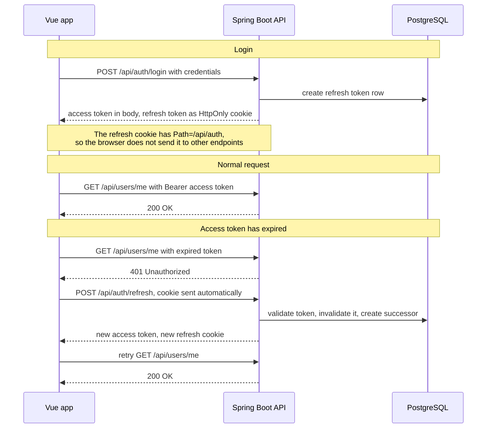

# handout-manager

A full-stack web app that lets tabletop RPG game masters run campaigns and selectively
share notes, handouts and files with individual players. Access is a whitelist: a player
sees exactly what has been released to them, and nothing else.

## Authentication

The access token is a short-lived JWT the frontend keeps in memory. The refresh token
lives in an HttpOnly cookie and is managed server side with rotation: every use
invalidates the old row and writes a successor. An Axios interceptor handles expiry
without the user noticing, and concurrent 401s share a single in-flight refresh, so a
burst of requests triggers one refresh rather than several. That sharing is not an
optimisation: a second refresh would present a token the first one has already rotated,
which the server treats as a possible theft.



## Status

**Learning project.** MVP step 1 (authentication, user management and password reset) is
complete, covered by 88 backend tests and 22 frontend tests. Step 2 (projects,
memberships, resources) is next.

**Not ready to run in public.** The gaps are listed under
[Before deploying this](#before-deploying-this). They are deliberate omissions, not
oversights, but they do matter.

## Stack

| | |
|---|---|
| Backend | Java 25, Spring Boot 4.1, Spring Security, jjwt 0.13.0 |
| Database | PostgreSQL 18, Flyway migrations |
| Frontend | Vue 3, TypeScript, Tailwind 4, Pinia, Vue Router, Axios |
| Tests | JUnit 6, Mockito, AssertJ, Testcontainers · Vitest, @vue/test-utils, Playwright |
| CI | GitHub Actions, backend and frontend as two parallel jobs |

## Running it locally

### Prerequisites

JDK 25, Node 24, Docker.

`JAVA_HOME` has to point at the JDK 25 installation. `./mvnw` follows it, not the JDK
configured in your IDE. Check with `./mvnw -v`.

### 1. Database

```bash
docker compose up -d
```

Starts PostgreSQL 18 with the database, user and password the `local` profile expects.
The credentials in `docker-compose.yml` are development values; the file is not meant to
be deployed as it is.

### 2. Environment variables

Three values have no defaults on purpose. Without them the application refuses to start
rather than falling back to something unsafe:

| Variable | Notes |
|---|---|
| `JWT_SECRET` | At least 44 characters. Generate one with `openssl rand -base64 33`. |
| `MAIL_USERNAME` | SMTP credentials. In development, a [Mailtrap](https://mailtrap.io) sandbox inbox. |
| `MAIL_PASSWORD` | |

Mailtrap collects every outgoing mail in a web inbox instead of delivering it, so no test
mail can reach a real recipient. Host and port for it are already in the `local` profile.

### 3. Backend

```bash
cd backend
./mvnw spring-boot:run -Dspring-boot.run.profiles=local
```

The `local` profile is required: it supplies the datasource, the SMTP host and the reset
link base, and it turns off the `Secure` cookie flag so a browser will accept the refresh
cookie over plain HTTP. Without the profile there is no database configuration at all.

*PowerShell splits `-D` arguments at the dot, so quote them:
`"-Dspring-boot.run.profiles=local"`.*

Runs on `http://localhost:8080`.

### 4. Frontend

```bash
cd frontend
npm ci
npm run dev
```

Runs on `http://localhost:5173`. The API base URL comes from `frontend/.env`.

## Tests

```bash
cd backend
./mvnw test      # 80 unit, web-layer and context tests
./mvnw verify    # the above plus 8 integration tests against a real database
```

`verify` starts PostgreSQL in a container through Testcontainers, so Docker has to be
running. The split is deliberate: `test` stays fast enough for the inner loop.

```bash
cd frontend
npm run test:unit
npm run type-check
npm run lint
npm run test:e2e   # Playwright; run npx playwright install once beforehand
```

The end-to-end test needs no backend: it stubs the refresh endpoint and checks that the
route guard sends a visitor without a session to the login form.

## Layout

```
handout-manager/
├── backend/             Spring Boot application, feature-based packages
├── frontend/            Vue 3 application
├── docs/                planning, naming conventions, Postman collection
└── docker-compose.yml   PostgreSQL for development
```

## Documentation

`docs/` holds more than API notes. Every design decision in this project is written down
with its reasoning, including the ones that turned out to be wrong and the limits that
were accepted on purpose:

- `handout-manager-planning.md`: domain model, field model, and the decision log
- `naming-conventions.md`: naming and conventions across Java, Vue, SQL, REST and Git
- `handout-manager.postman_collection.json`: the API for manual testing

**The two Markdown documents are written in German.** Everything inside the codebase,
including identifiers, comments, commit messages and SQL, is English.

## Before deploying this

Four things are missing or need a decision first:

- **No rate limiting anywhere.** Login accepts unlimited attempts, and
  `POST /api/auth/password-reset/request` sends unlimited mail to any address somebody
  types in. The second one is the worse of the two: it lets anyone flood a stranger's
  inbox and get the sending domain onto spam lists.
- **CSRF protection is off, and that is only safe as long as frontend and backend count as
  the same site.** The access token travels in a header, which a foreign page cannot set,
  and the refresh cookie is `SameSite=Strict`. Split the two across domains and `SameSite`
  has to drop to `None`, at which point CSRF becomes real and `/api/auth/refresh` needs
  protection.
- **Mail needs a real provider.** Switching away from Mailtrap is configuration, not code,
  but a real provider only accepts a verified domain: SPF, DKIM and DMARC records are the
  actual work.
- **No cleanup job** for expired and used token rows in `refresh_token` and
  `password_reset_token`.

In production, all configuration comes from the environment. The datasource reads
`SPRING_DATASOURCE_URL`, `SPRING_DATASOURCE_USERNAME` and `SPRING_DATASOURCE_PASSWORD`
directly; no credential has a default anywhere in the committed configuration.

## Author

Philipp Reischer, full-stack developer in Vienna.
Other projects: [philippreischer.github.io](https://philippreischer.github.io)
